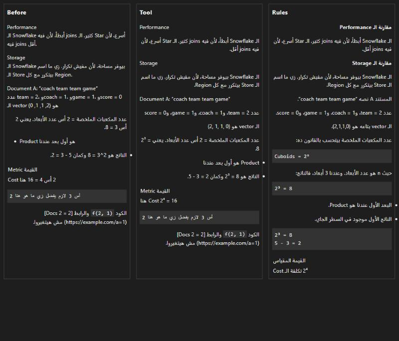

# أداة arabic-mixed-text

مهارة (Skill) لـ Claude Code بتخلي الشرح العربي اللي فيه مصطلحات إنجليزية ومعادلات يتقري بالترتيب الصح، ومعاها أداة Python بتصلّح الملفات الجاهزة.



## سبب المشكلة

معظم تطبيقات الشات بتحدد اتجاه الفقرة من أول حرف فيها. لو الفقرة بدأت بكلمة إنجليزية، بتتعرض كلها من الشمال لليمين والجمل العربي بتتلخبط.

وفي الفقرة العربي، الأرقام والعلامات المنفصلة بتتعكس. يعني المعادلة والقوائم الرقمية بتظهر بالمقلوب.

## الأمثلة

الأمثلة دي معروضة زي ما GitHub بيعرضها فعلًا، فهتشوف المشكلة والحل قدامك.

### المثال 1: فقرة بتبدأ بكلمة إنجليزية

❌ قبل:

> Performance: الـ Snowflake أبطأ، لأن فيه joins كتير.

✅ بعد:

> أداء الـ Performance: الـ Snowflake أبطأ، لأن فيه joins كتير.

القاعدة: ابدأ كل فقرة بكلمة عربي.

### المثال 2: عنوان إنجليزي فوق شرح عربي

❌ قبل:

> Storage<br>
> الـ Snowflake بيوفر مساحة، لأن مفيش تكرار.

✅ بعد:

> **مقارنة الـ Storage**
>
> الـ Snowflake بيوفر مساحة، لأن مفيش تكرار.

القاعدة: اكتب العنوان بكلمة عربي في أوله، وسيب سطر فاضي قبل الشرح.

### المثال 3: اسم مستند أو تعريف

❌ قبل:

> Document A: الجملة دي فيها coach و team.

✅ بعد:

> المستند A: الجملة دي فيها coach و team.

### المثال 4: الأس بالكلام

❌ قبل:

> يعني 2 أس 3 = 8.

✅ بعد:

> يعني الناتج:
>
> ```text
> 2³ = 8
> ```

القاعدة: استخدم الرمز الحقيقي، وحط المعادلة في سطر لوحدها.

### المثال 5: الأس لما يكون مفهوم مش رقم

❌ قبل:

> عدد المكعبات الملخصة = 2 أس عدد الأبعاد.

✅ بعد:

> عدد المكعبات الملخصة بيتحسب بالقانون ده:
>
> ```text
> Cuboids = 2ⁿ
> ```
>
> حيث n هو عدد الأبعاد.

### المثال 6: الـ vector والقوائم الرقمية

❌ قبل:

> الـ vector هو (2, 1, 1, 0).

✅ بعد:

> الـ vector هو (2,1,1,0).

القاعدة: اكتب القائمة القصيرة من غير مسافات بعد الفصلة.

### المثال 7: الطرح والأرقام السالبة

❌ قبل:

> الفرق هو 5 - 3 = 2 والقيمة -5.

✅ بعد:

> الفرق والقيمة موجودين تحت:
>
> ```text
> 5 - 3 = 2
> x = -5
> ```

### المثال 8: القوائم

❌ قبل:

- Product هو أول بعد عندنا.
- Region هو تاني بعد عندنا.

✅ بعد:

- البعد الأول عندنا هو Product.
- البعد التاني عندنا هو Region.

### المثال 9: الجداول

❌ قبل:

| Metric | Value |
|---|---|
| Cost هنا عالي | 2 أس 4 |

✅ بعد:

| المقياس | القيمة |
|---|---|
| تكلفة الـ Cost عالية | 2⁴ |

## القواعد باختصار

| الحالة | الطريقة الصح |
|---|---|
| بداية أي فقرة أو عنوان | كلمة عربي |
| سطرين ورا بعض | سطر فاضي بينهم |
| أي معادلة | سطر لوحدها في code block |
| الأسس والرموز | `2³` و `2ⁿ` و `×` و `≤` و `≠` و `√` |
| قائمة أرقام قصيرة | من غير مسافات، زي `(2,1,1,0)` |
| الطرح والسالب والأسهم | جوه code block |
| المصطلحات التقنية | بالإنجليزي من غير ترجمة |

## التثبيت

شغّل الأمر ده، وهو بيشتغل في PowerShell و Git Bash:

```bash
git clone https://github.com/abdellrrahman/arabic-mixed-text.git "$HOME/.claude/skills/arabic-mixed-text"
```

بعد كده افتح session جديدة في Claude Code، وهيستخدم الـ skill لما يكتب عربي فيه مصطلحات أو معادلات.

## التشغيل الدائم

عشان القواعد تتطبق في كل session من غير ما تعتمد على اختيار Claude للـ skill، ضيف ده لملف `~/.claude/CLAUDE.md`:

```markdown
# Arabic replies

When writing in Arabic, always keep mixed Arabic and English text readable. The chat app sets each paragraph's direction from its first letter, so these rules prevent scrambled or reversed text:

- Explain in Arabic, in the user's dialect, and keep technical terms in English.
- Start every paragraph, list item, heading, and mixed table cell with an Arabic word.
- Separate lines with a blank line, because a single line break stays in the same paragraph.
- Put each equation on its own line in a code block, then explain it in Arabic.
- Use real math symbols such as `2³`, `2ⁿ`, `×`, `≤`, `≠`, `√`, never the word "أس" or caret notation.
- Write inline number lists without spaces after commas, such as `(2,1,1,0)`.
- Keep subtraction, negative numbers, and arrows out of Arabic sentences by using a code block.

For full examples, or to repair an Arabic Markdown file, use the `arabic-mixed-text` skill.
```

## تصليح ملف جاهز

الأداة محتاجة Python 3.7 أو أحدث، ومن غير أي مكتبات إضافية.

لكتابة النتيجة في ملف جديد:

```bash
python "$HOME/.claude/skills/arabic-mixed-text/scripts/bidi_fix.py" input.md -o output.md
```

لتعديل نفس الملف:

```bash
python "$HOME/.claude/skills/arabic-mixed-text/scripts/bidi_fix.py" input.md --in-place
```

لفحص الملف من غير تعديله:

```bash
python "$HOME/.claude/skills/arabic-mixed-text/scripts/bidi_fix.py" input.md --check
```

اللي الأداة بتعمله:

- بتحوّل الأسس لرموز، زي `2 أس 3` و `2^3` لـ `2³`.
- بتضيف علامات اتجاه مخفية في أول السطور المختلطة وحوالين المعادلات.
- بتفصل السطور اللي ورا بعض بسطر فاضي.
- بتسيب الـ code blocks والروابط ومحتوى الكود زي ما هم.

ولو شغلتها مرتين على نفس الملف النتيجة مش بتتغير.

## ملفات الأمثلة

| الملف | المحتوى |
|---|---|
| [الملف before.md](examples/before.md) | النص الأصلي قبل التصليح |
| [الملف after-tool.md](examples/after-tool.md) | ناتج الأداة على نفس النص |
| [الملف after-rules.md](examples/after-rules.md) | نفس النص مكتوب بالقواعد |

## الحدود

- العبارة `2 أس عدد الأبعاد` الأداة مش بتغيرها، لكنها بتطبع تحذير عشان تتكتب بالرمز `2ⁿ` يدويًا.
- الحل معمول للتطبيقات اللي بتحدد الاتجاه من أول حرف. البرامج اللي بتجبر النص كله من الشمال لليمين محتاجة إعداد منها.

## الرخصة

المشروع متاح برخصة MIT، وتفاصيلها في [ملف LICENSE](LICENSE).
